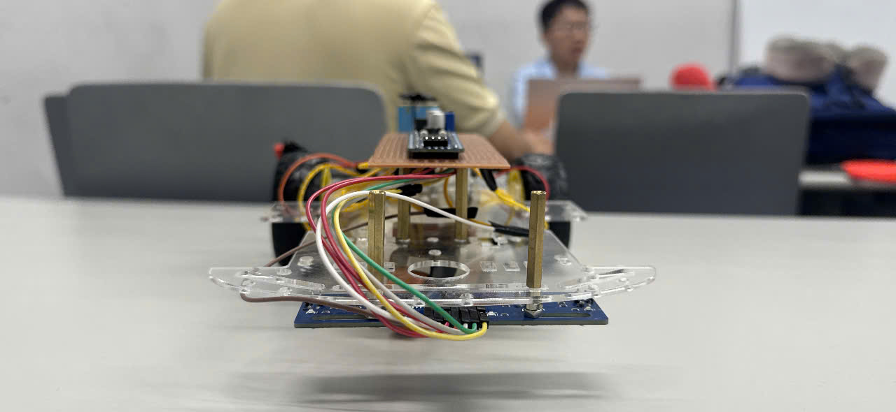
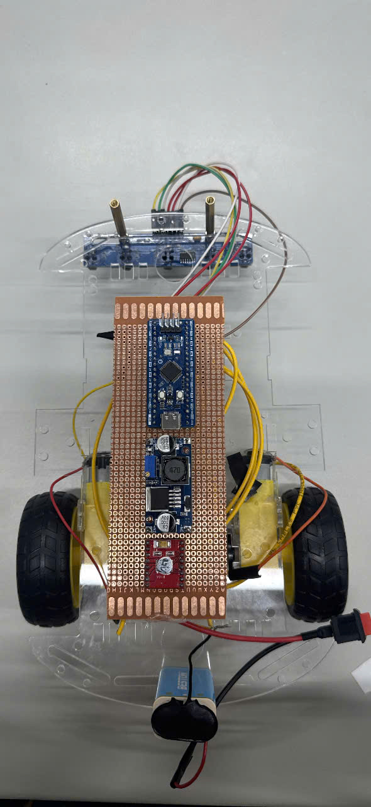
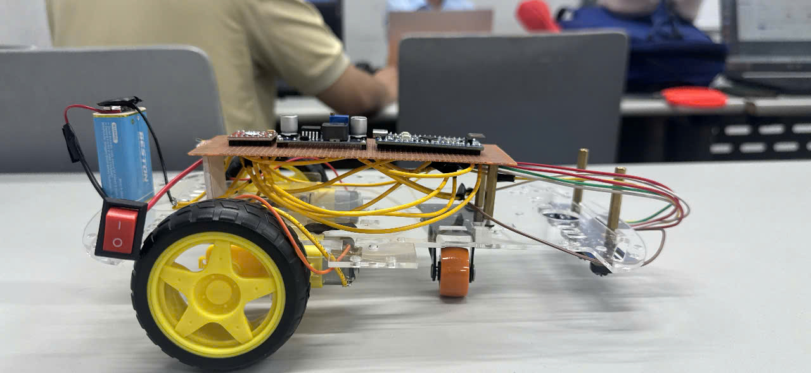
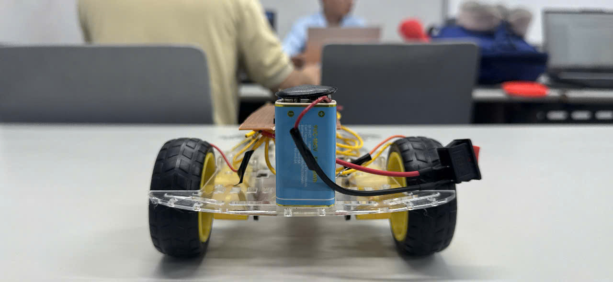
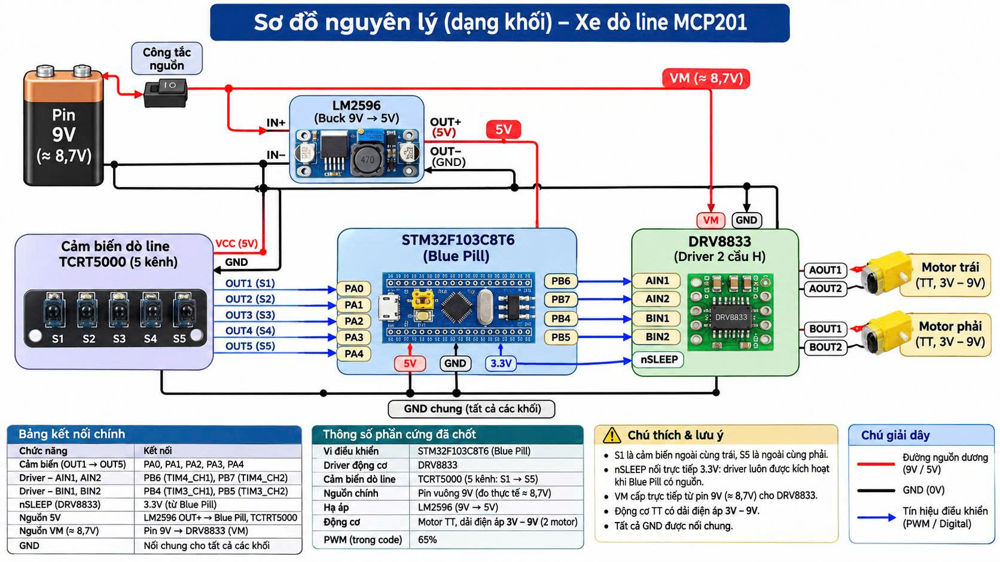

# MCP201 — STM32 Line Following Robot

**Microcontroller Programming | STM32F103C8T6 | 5-Channel Line Tracking | PWM Motor Control**

**Course:** MCP201 — Microcontroller Programming  
**Platform:** STM32 Blue Pill (STM32F103C8T6)  
**Development Environment:** STM32CubeIDE  
**Project Type:** Line Following Robot

---

## 1. Project Overview

This project focuses on the design and implementation of an autonomous line-following robot using an STM32F103C8T6 microcontroller.

The robot uses a five-channel infrared sensor array to detect a line on the ground. Based on the sensor readings, the STM32 controls two DC motors through a DRV8833 motor driver.

The main objectives are:

- Interface infrared sensors with STM32 GPIO inputs.
- Generate PWM signals using hardware timers.
- Control the speed and direction of two DC motors.
- Implement line-following decision logic.
- Evaluate practical hardware and software limitations.

The repository contains firmware source files, project configuration, robot photographs, and technical documentation.


### 1.1 Robot Prototype

The following photographs show the physical implementation of the STM32 line-following robot.

**Front View**



**Top View**



**Side View**



**Rear View**




## 2. System Architecture

### 2.1 Circuit Diagram

The following diagram illustrates the electrical connections of the STM32 line-following robot.




### 2.1 Hardware Components

| Component | Description |
|---|---|
| Microcontroller | STM32F103C8T6 Blue Pill |
| Sensor | 5-channel TCRT5000 infrared tracking module |
| Motor Driver | DRV8833 |
| Motors | Two TT geared DC motors, rated 3–9 V |
| Voltage Regulator | LM2596 DC-DC step-down module |
| Power Supply | 9 V battery |
| Development Tool | STM32CubeIDE |

### 2.2 System Operation

The five infrared sensors detect the line position and provide digital signals to the STM32.

The microcontroller processes the sensor states and determines the appropriate motor control action.

Hardware PWM signals are generated by STM32 timers and sent to the DRV8833 motor driver.

The motor driver controls the left and right motors to adjust the robot's movement.

### 2.3 Pin Connections

| STM32 Pin | Function | Connected Device |
|---|---|---|
| PA0 | Sensor input 1 | TCRT5000 OUT1 |
| PA1 | Sensor input 2 | TCRT5000 OUT2 |
| PA2 | Sensor input 3 | TCRT5000 OUT3 |
| PA3 | Sensor input 4 | TCRT5000 OUT4 |
| PA4 | Sensor input 5 | TCRT5000 OUT5 |
| PB6 | TIM4_CH1 | DRV8833 AIN1 |
| PB7 | TIM4_CH2 | DRV8833 AIN2 |
| PB4 | TIM3_CH1 | DRV8833 BIN1 |
| PB5 | TIM3_CH2 | DRV8833 BIN2 |

The DRV8833 nSLEEP input is connected to the 3.3 V supply.

The battery supplies the motor driver and the LM2596 regulator. The regulator provides 5 V for the microcontroller board and sensor module. All components share a common ground.

**Electrical note:** Sensor output voltage compatibility and power supply stability must be verified before operation.

## 3. Project Directory Structure

```text
MCP201-STM32-Line-Follower/
|
|-- README.md
|-- .gitignore
|-- .project
|-- .cproject
|-- doline1.ioc
|-- doline1.zip
|-- main.c
|-- main.h
|
|-- apps/
|   |-- README.md
|
|-- images/
|   |-- front.jpg
|   |-- Rear.jpg
|   |-- Side.jpg
|   |-- Side_2.jpg
|   |-- Top-Down.jpg
|   |-- Down-Top.jpg
|   |-- lalala.c
|
|-- Docx/
|   |-- J4F_MCP201_BAO_CAO_CHINH_THUC.pdf
|   |-- Xe_Tự_Hành_Dò_Line_STM32.pptx
|
|-- J4F_MCP201_BAO_CAO_Draw.docx
|-- 1794224300982_4389226855427903812_4389226855427903812_1292c57cd401d00322f4e694686c0726.jpg
```

### 3.1 Firmware Source Files

- `main.c`: Main application source code.
- `main.h`: Application header file.
- `doline1.ioc`: STM32CubeMX peripheral configuration.
- `.project` and `.cproject`: STM32CubeIDE project metadata.
- `doline1.zip`: Archived project package.

The archive is provided for project sharing. Its completeness and build reproducibility have not yet been independently verified.

### 3.2 Images

The `images/` directory contains photographs showing different views of the robot.

### 3.3 Technical Documentation

- [Final Project Report (PDF)](Docx/J4F_MCP201_BAO_CAO_CHINH_THUC.pdf)
- [Project Presentation (PPTX)](Docx/Xe_Tự_Hành_Dò_Line_STM32.pptx)
- [Report Draft (DOCX)](J4F_MCP201_BAO_CAO_Draw.docx)

## 4. Firmware Implementation

### 4.1 Sensor Interface

Five GPIO input pins are used to read the digital outputs of the infrared sensor module.

The firmware interprets the sensor states to estimate the line position.

### 4.2 Motor Control

The DRV8833 controls two DC motors using four control inputs.

PWM signals are generated through STM32 TIM3 and TIM4 channels.

The firmware adjusts motor operation according to the detected line position.

### 4.3 Line Following Logic

The control process consists of:

1. Read the five infrared sensors.
2. Determine the detected line position.
3. Select the corresponding steering action.
4. Update the motor control outputs.
5. Repeat the control cycle.

The detailed implementation is available in `main.c`.

## 5. Testing and Observations

The robot has been tested on a physical line-following track.

Preliminary observations include:

- The robot can follow some simple track sections.
- Sensor readings may become unstable under certain conditions.
- Tight turns and intersections remain challenging.
- Power supply voltage drops have been observed under motor load.

These observations describe the development status and do not establish a complete performance benchmark.

Quantitative success rates, repeatability measurements, and standardized track test results have not yet been documented in this README.

## 6. Technical Issues and Limitations

### 6.1 Power Supply Stability

Voltage drops under motor load may affect the microcontroller and sensor system.

The 9 V battery and power distribution require further evaluation under operating conditions.

### 6.2 Sensor Reliability

Infrared sensor readings depend on the surface, sensor height, calibration, and electrical conditions.

Unstable readings can affect steering decisions.

### 6.3 Track Complexity

The current system has not been demonstrated to reliably handle every sharp turn or intersection.

Further control algorithm improvements and repeatable testing are required.

## 7. Project Setup

1. Install STM32CubeIDE.
2. Download or clone this repository.
3. Extract `doline1.zip` if using the archived project.
4. Import the STM32CubeIDE project into the workspace.
5. Verify the microcontroller, GPIO configuration, timer settings, and pin mapping.
6. Build the project.
7. Connect the STM32 board using a compatible programming/debugging interface.
8. Flash the firmware and test the robot.

**Note:** A successful clean build from a fresh clone has not yet been independently confirmed.

## 8. Project Team

This project is developed collaboratively by four GitHub contributors.

Team members:

- [Nathan6426](https://github.com/Nathan6426)
- [6626hieunguyen-tech](https://github.com/6626hieunguyen-tech)
- [Andytvyt](https://github.com/Andytvyt)
- [thientam615123](https://github.com/thientam615123)

Individual responsibilities and technical contributions should be documented according to the work performed by each team member.

## 9. Conclusion

This project demonstrates the integration of STM32 GPIO, timer-based PWM, infrared sensors, and DC motor control in an embedded robotic system.

The current implementation provides a practical foundation for line-following experiments.

Future development should focus on power supply reliability, sensor calibration, improved steering control, and systematic performance evaluation.

---

**MCP201 — Microcontroller Programming**

**STM32 Line Following Robot Project**

